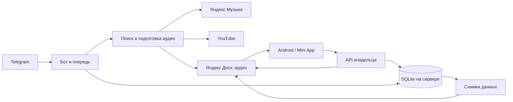

# Как всё работает

## Песня

`aidj.bot` принимает запрос и сохраняет задание. `aidj.worker` обрабатывает задания
по одному под общим файловым замком. `sources` и `pipeline` выбирают версию,
загружают аудио, `audio`/`clips` готовят файл. `disk` проверяет сохранность загрузки.
Крупные данные идут потоково и удаляются из временного каталога после обработки.

`playlists` хранит принадлежность, порядок и алиасы, делает копии внутри Диска
и пишет M3U8. Повтор источника или одинаковый MD5+размер использует прежнюю запись.
Похожие названия проверяются по исполнителю, словам и длительности, но не сливаются
автоматически: аудиоотпечатков в этой версии нет.

## Разметка и предложения

`reviews`, `review_ui`, `review_worker` выдают друзьям аудио в Telegram и принимают
оценки. У каждого своя очередь, один голос на песню, исправление голоса разрешено.
Выдача случайная с весами: неоценённая песня — 1, песня с дизлайком — 1,25,
песня только с положительными/нейтральными оценками — 1 / (1 + число оценок).
Число дизлайков не усиливает бонус. Уже оценённые или пропущенные этим человеком
песни исключаются, в том числе совпадающие по MD5 копии под другим названием. Telegram file_id позволяет
повторно отправлять уже загруженное аудио без повторной загрузки файла на VM.

Предложение проходит предпрослушивание → подтверждение автора → общий пул разметки.
`review_delivery` сохраняет его в «Предложку» и отдельно доставляет поздравления
после принятия владельцем в Volleyball. После удаления из общего плейлиста
отдельная очередь уведомляет тех, чей последний голос за эту запись — дизлайк.
Повтор того же действия не создаёт повторное уведомление; если песню вернули
до отправки, уведомление отменяется. Ошибки Диска и Telegram повторяются через
постоянные записи в БД. Скачивание предложения на телефон включается только владельцем.

Добавление и удаление в приложении сразу меняют видимый список. `playlist-changes.mjs`
сохраняет намерения в локальную очередь, затем последовательно отправляет их на сервер.
Очередь переживает перезапуск приложения; обрывы связи и ошибки Диска повторяются с тем же
`opId`, поэтому сервер продолжает незавершённую операцию без повторного копирования и уведомлений.
До подтверждения в шапке видно «Сохраняю…». Окончательный отказ возвращает актуальный список
и показывает ошибку. Порядок и переименование ждут завершения этих операций, чтобы не
перезаписать ещё не сохранённый состав. Сервер выполняет Диск и M3U в запросе; начатый запрос
продолжается при закрытии экрана, а неотправленные намерения возобновляются при открытии приложения.

`review_web` даёт владельцу те же оценки и управление в приложении. Клиент не может
подставить чужой user id: сервер берёт владельца из своей БД. Имена участников не
отдаются неавторизованным клиентам. Фильтр по минимуму использует лайки минус
дизлайки, принимает отрицательный порог; пустое поле отключает ограничение.
Счётчик показывает число подходящих песен из полного списка, до разбиения на страницы.
Владелец также получает в каталоге список участников и последние голоса по MD5:
стабильный идентификатор участника не зависит от смены Telegram-ника. Эти данные
доступны только в авторизованном каталоге и сохраняются в локальном кеше приложения.
Фильтры поддерживают несколько оценок у одного человека (ИЛИ) и сочетание людей
по всем условиям (И) либо по любому (ИЛИ). Отсутствие голоса — отдельный вариант,
не равный нейтральной оценке. Старый кеш без матрицы голосов не считается данными
об отсутствии оценок. Свой несинхронизированный голос учитывается сразу.
Выбор сохраняется отдельно для каждого плейлиста/раздела и применяется к очереди
при запуске через «Слушать»/«Шафл», не меняя состав плейлиста.

Второй режим фильтрации — «По важности». Упорядоченный список людей задается
в приложении перетаскиванием за ручку, с автопрокруткой и управлением стрелками.
Для каждой песни `priorityRating` берет первый 👍/👎 в этом порядке; нейтральные
и отсутствующие голоса пропускаются. Если решающих голосов нет, итог отсутствует.
Недоступные данные вышестоящего участника не считаются отсутствием голоса.
По умолчанию остаются только итоговые лайки; можно выбрать дизлайки и песни
без итоговой оценки. Режим заменяет обычные условия по людям и суммарным оценкам,
сохраняя их для обратного переключения. Реальные голоса и членство в плейлисте
не меняются. Порядок и режим сохраняются локально отдельно для каждого раздела.
Рядом с песней отображаются итог и автор решающего голоса.

## Приложение

`miniapp/` — интерфейс без отдельного frontend build. Он работает в Telegram,
браузере и встроенном WebView Android. `webapp` принимает только владельца через
Telegram initData или одноразовую ссылку; браузеру выдаётся отзываемая сессия.
Аудио с Диска передаётся с поддержкой Range; OAuth Диска клиенту не выдаётся.

Android (`android/src/com/aidj/music`) использует foreground MediaPlayer/MediaSession
для воспроизведения. Загрузку всей очереди выполняет отдельный `DownloadRunner`:
на всех поддержанных версиях Android явный запуск использует foreground-службу
`dataSync`. Если её запуск запрещён, есть резервное задание UIDT на Android 14+.
Скрытые фоновые запросы из бота получают обычное
сетевое задание с восстановлением состояния; при открытом приложении оно может
быть повышено до загрузки, запущенной пользователем.
Одна очередь и одно уведомление с отдельным тихим каналом, без звука/вибрации.
Передача идёт через HTTP Range в `.part`; после обрыва процесс продолжает с длины
файла. Указанные размер и MD5 проверяются перед атомарным переименованием.
Ошибки сети/429/5xx повторяются с ограниченной задержкой, отдельный 404 не
останавливает остальные песни; отсутствие места или истёкший вход требуют действия.
Пауза сохраняет частичные байты, отмена удаляет только незавершённые файлы.
Команды паузы/продолжения задают нужное состояние, поэтому повторное «Продолжить»
не переключает очередь обратно в паузу. Ошибки отдельных файлов показываются
отдельно от остановки всей очереди; фоновые подтверждения не отменяют ручную паузу.
Ответ 403 на аудио проверяется через `/api/session`: пока вход действителен,
ошибка файла повторяется без остановки остальных песен.
SQLite v2 мигрирует таблицу загрузок через ALTER, сохраняя ранее скачанные песни.
Старые активные запросы DownloadManager переносятся с сохранением доступного префикса.
Снимки очереди и кеша строятся вне UI-потока; готовые файлы не хешируются каждую секунду.

Платформенный контракт: [UIDT](https://developer.android.com/develop/background-work/background-tasks/uidt).
Ограничения ОС, принудительная остановка приложения и ограничения производителя
могут приостановить задачу; очередь и частичные файлы сохраняются для продолжения.
Очередь загрузок и локальные файлы переживают
сворачивание Telegram. `device_inbox` синхронизирует явные запросы скачивания по устройствам.
Владелец также передаёт через этот авторизованный запрос ограниченный статус загрузчика:
версию APK/Android, причину паузы, режим работы, код HTTP, свободное место и счётчики.
Сервер хранит только разрешённые поля в `device_diagnostics`, не больше 10 устройств
за 7 дней. Cookies, заголовки, URL и произвольный текст не сохраняются. Этот временный
статус не входит в резервные копии и позволяет диагностировать остановку без ручной
передачи пользователем логов с телефона.

## Хранение и резервные копии

`store` задаёт схему SQLite. Музыка находится на Диске; в БД — пути, идентичность,
порядок, оценки, авторы и состояния операций. `backup` строит согласованный снимок
только разрешённых таблиц, без секретов и сессий. Сначала загружается и проверяется
новый слот, затем публикуется `latest.json`; предыдущий слот остаётся доступен.

Резервная копия не заменяет приватное хранение токенов и ключа подписи Android.

## DJ-подготовка и воспроизведение

`aidj.dj` хранит небольшие данные по MD5 в `dj_analysis`, отдельный
`aidj.dj_worker` готовит их последовательно по запросу `/api/dj`. Числовая
разметка входит в каталог и резервное копирование. Ритм (librosa) и границы
вокальных фраз (faster-whisper) считаются в разных процессах, чтобы их память
не складывалась. Подробности установки и ограничения — [DJ_PREVIEW.md](DJ_PREVIEW.md).

В телефоне режим и целевая длина запоминаются отдельно для плейлистов. `dj.mjs`
планирует фрагменты и небольшую подстройку темпа в локальной очереди.
`PlaybackService` заранее готовит вторую дорожку из прежнего скачанного файла
или сетевого потока, накладывает её и передаёт управление обычному следующему
элементу очереди. Оригинальные файлы и ручные фрагменты не меняются.
