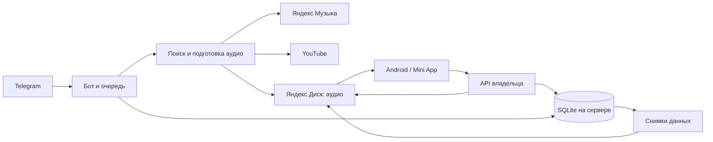

# Как всё работает

## Песня

`aidj.bot` принимает запрос и сохраняет задание. `aidj.worker` обрабатывает задания
по одному под общим файловым замком. `sources` и `pipeline` выбирают версию,
загружают аудио, `audio`/`clips` готовят файл. `disk` проверяет сохранность загрузки.
Крупные данные идут потоково и удаляются из временного каталога после обработки.

`playlists` хранит принадлежность, порядок и алиасы, делает копии внутри Диска
и пишет M3U8. Повтор источника или одинаковый MD5+размер использует прежнюю запись.
Похожие названия проверяются по исполнителю, словам и длительности, но не сливаются
автоматически: аудиоотпечатков в этой версии нет.

## Разметка и предложения

`reviews`, `review_ui`, `review_worker` выдают друзьям аудио в Telegram и принимают
оценки. У каждого своя очередь, один голос на песню, исправление голоса разрешено.
Сначала выдаются песни с наименьшим числом оценок. Telegram file_id позволяет
повторно отправлять уже загруженное аудио без повторной загрузки файла на VM.

Предложение проходит предпрослушивание → подтверждение автора → общий пул разметки.
`review_delivery` сохраняет его в «Предложку» и отдельно доставляет поздравления
после принятия владельцем в Volleyball. Ошибки Диска и Telegram повторяются через
постоянные записи в БД. Скачивание предложения на телефон включается только владельцем.

`review_web` даёт владельцу те же оценки и управление в приложении. Клиент не может
подставить чужой user id: сервер берёт владельца из своей БД. Имена участников не
отдаются неавторизованным клиентам.

## Приложение

`miniapp/` — интерфейс без отдельного frontend build. Он работает в Telegram,
браузере и встроенном WebView Android. `webapp` принимает только владельца через
Telegram initData или одноразовую ссылку; браузеру выдаётся отзываемая сессия.
Аудио с Диска передаётся с поддержкой Range; OAuth Диска клиенту не выдаётся.

Android (`android/src/com/aidj/music`) использует foreground MediaPlayer/MediaSession
для воспроизведения и системный DownloadManager для последовательных загрузок.
Скачанное проверяется по размеру и MD5. Очередь загрузок и локальные файлы переживают
сворачивание Telegram. `device_inbox` синхронизирует явные запросы скачивания по устройствам.

## Хранение и резервные копии

`store` задаёт схему SQLite. Музыка находится на Диске; в БД — пути, идентичность,
порядок, оценки, авторы и состояния операций. `backup` строит согласованный снимок
только разрешённых таблиц, без секретов и сессий. Сначала загружается и проверяется
новый слот, затем публикуется `latest.json`; предыдущий слот остаётся доступен.

Резервная копия не заменяет приватное хранение токенов и ключа подписи Android.
